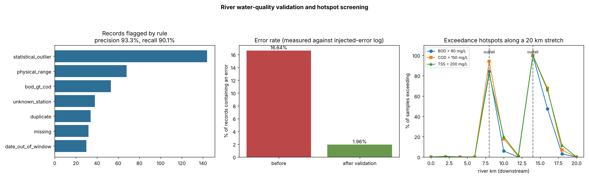

# River Water-Quality Data Validation and Hotspot Screening

> **Simulation-based case study.** A clean "truth" dataset is generated (11 stations over a 20 km river stretch, weekly samples 2022–2024), then known data-entry errors are injected and logged. Because every error is known, the validator's performance is **measured**, not claimed.



## Pipeline
1. **Generate truth:** pH, DO, BOD, COD, TSS and temperature, with two hypothetical industrial outfalls (km 8 and km 14), seasonal temperature effects and 2% genuine storm events (real extreme values, not errors).
2. **Inject errors (≈15% of records + 2% duplicates):** µg/L entered as mg/L, decimal shifts, impossible values, station-code typos, missing values, future dates, BOD > COD, and subtle ±30% transcription errors.
3. **Validate (7 rules):** missing values, unknown station, date window, physical range, BOD ≤ COD consistency, exact duplicates, robust z-score (median/MAD, log scale for concentrations) per station.
4. **Evaluate** flags against the injected-error log.
5. **Screen exceedances** on validated data against screening thresholds.

## Measured results
| Metric | Value |
|---|---|
| Records | 1,761 |
| Error rate before validation | 16.64% |
| Error rate after removing flagged records | **1.96%** |
| Precision / recall | 93.3% / 90.1% |
| False positives / missed errors | 19 / 29 |
| Worst hotspot | RS-07 (km 14): BOD above 80 mg/L in 100% of samples, median excess 81% |

**Honest limitations**
- Subtle ±30% transcription errors are almost undetectable by rules (6.5% caught). Catching them needs duplicate entry or sensor cross-checks.
- Most false positives are genuine storm events flagged as outliers. In practice these should be reviewed, not deleted.

## Thresholds
pH 6–9, BOD 80 mg/L, COD 150 mg/L and TSS 200 mg/L are the Pakistan NEQS limits for effluent discharge to inland waters. They are used here only as **screening values**; ambient river standards differ. The DO minimum of 5 mg/L is an representative aquatic-life guideline.

## Run
```bash
python3 -m unittest discover -s tests -v
python3 src/run.py        # writes data/ and outputs/
```
Outputs: `outputs/metrics.json`, `outputs/validation_flags.csv`, `outputs/exceedance_by_station.csv`, `outputs/dashboard.png`.

Author: Mohammad Rabbani – Sustainability Data Analyst & Research Consultant

## Links
- Kaggle notebook: https://www.kaggle.com/rabbani0123 (runnable copy of `notebook.ipynb`)
- Author: Mohammad Rabbani | Sustainability Data Analyst & Research Assistant

## License
MIT
